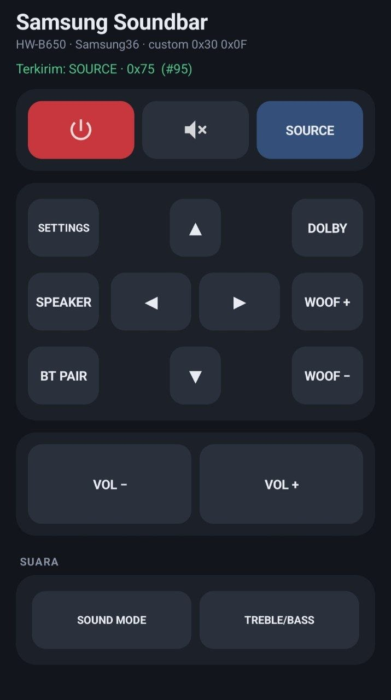

<div align="center">

# Samsung HW-B650 Remote

**Remote kontrol lengkap untuk soundbar Samsung HW-B650, lewat IR blaster ponsel Android.**

[](https://github.com/bangunw/Samsung-HWB650-Remote/releases/latest)




### [⬇ Unduh SoundbarRemote.apk](https://github.com/bangunw/Samsung-HWB650-Remote/releases/latest/download/SoundbarRemote.apk)

</div>

---

## Tentang

Aplikasi ini menggantikan remote fisik soundbar **Samsung HW-B650** yang hilang atau rusak. Cukup pakai ponsel yang punya IR blaster.

Setiap kode IR sudah diuji langsung pada soundbar. Aplikasi ini juga bisa mengirim beberapa perintah yang tidak ada di remote bawaan.

## Fitur

| | |
|---|---|
| 🎛️ **Kontrol lengkap** | Power, Mute, Source, navigasi ▲ ▼ ◀ ▶, Volume, Woofer, Dolby, Sound Mode, Treble/Bass, Settings, Speaker, BT Pair |
| 🔁 **Tahan untuk mengulang** | Volume, Woofer, dan navigasi terus mengirim kode selama tombol ditahan |
| 📳 **Umpan balik** | Getar halus setiap tekanan, dan status menampilkan kode yang terkirim |
| 🔒 **Privasi** | Hanya izin `TRANSMIT_IR`. Tanpa internet, iklan, atau tracking |
| 🪶 **Ringan** | APK sekitar 20 KB, tanpa library pihak ketiga |
| 🌙 **Tema gelap** | Nyaman dipakai di ruangan redup |

## Instalasi

1. Unduh **[SoundbarRemote.apk](https://github.com/bangunw/Samsung-HWB650-Remote/releases/latest/download/SoundbarRemote.apk)** di ponsel.
2. Buka file APK, lalu izinkan install dari sumber tidak dikenal.
3. Arahkan ujung atas ponsel (IR blaster) ke soundbar, lalu tekan tombol.

> [!NOTE]
> Butuh **Android 5.0+** dan ponsel yang **punya IR blaster**, misalnya Xiaomi/Redmi/POCO, sebagian Huawei/Honor, atau Samsung lama. Kalau ponsel tidak punya IR blaster, aplikasi tetap terbuka tapi menampilkan peringatan.

## Protokol IR

Soundbar Samsung memakai format **Samsung36** dengan carrier **38 kHz**:

```
header      4500 / 4500 µs
custom      0x30 0x0F            (16 bit, LSB-first)
separator   500 µs mark + 4500 µs gap
payload     0000 + data (8 bit) + ~data (8 bit)
stop        500 µs mark

bit 0 = 500 / 500 µs     bit 1 = 500 / 1500 µs
```

Pola pulsanya dibuat oleh [`IrCodes.java`](src/com/bangun/sbremote/IrCodes.java). Untuk menambah tombol cukup satu byte `data`.

<details>
<summary><b>Daftar lengkap kode IR (29 tombol)</b></summary>

<br>

Kolom *data* adalah byte yang dikirim lewat IR.

| Tombol | data | Di aplikasi |
|---|:-:|:-:|
| Power | `0x70` | ✅ |
| Source / Input | `0x75` | ✅ |
| Volume Up | `0x77` | ✅ |
| Volume Down | `0x78` | ✅ |
| Mute | `0x71` | ✅ |
| Woofer Up | `0x82` | ✅ |
| Woofer Down | `0x83` | ✅ |
| Up | `0xB4` | ✅ |
| Down | `0xB5` | ✅ |
| Left | `0xB0` | ✅ |
| Right | `0xB1` | ✅ |
| Sound Mode / Sound Effect | `0x7B` | ✅ |
| Dolby | `0xC2` | ✅ |
| Treble/Bass | `0x98` | ✅ |
| Settings / Sound Control | `0xA6` | ✅ |
| Speaker | `0x88` | ✅ |
| BT Pair | `0xB7` | ✅ |
| Woofer (level) | `0x7A` | — |
| Surround / 3D Sound | `0x81` | — |
| Smart Volume | `0x7C` | — |
| Play/Pause / Enter | `0x8A` | — |
| Bluetooth Power | `0x9D` | — |
| Audio Sync + | `0x84` | — |
| Audio Sync − | `0x85` | — |
| Direct: D.IN (Optical) | `0x93` | — |
| Direct: Bluetooth | `0x96` | — |
| Direct: USB | `0x95` | — |
| Direct: HDMI | `0x97` | — |
| Test | `0xBF` | — |

Tanda **—** berarti kode itu tetap berfungsi tapi sengaja tidak ditampilkan supaya layar tetap sederhana. Untuk memunculkannya lagi, tambahkan satu baris `key(...)` di `MainActivity.java`.

Dolby, Treble/Bass, Test, dan HDMI awalnya kode yang tidak diketahui fungsinya. Fungsinya dipastikan dengan mencoba langsung di soundbar.

</details>

## Build dari source

Proyek ini **tidak memakai Gradle**. Build dilakukan langsung dengan tool dari Android SDK (`aapt2` → `javac` → `d8` → `apksigner`).

**Kebutuhan:** JDK 17, serta Android SDK dengan `build-tools/36.0.0` dan `platforms/android-34`.

```bash
export ANDROID_HOME=~/Android/Sdk   # sesuaikan
./build.sh
adb install -r SoundbarRemote.apk
```

Kalau belum ada keystore, `build.sh` akan membuat `debug.keystore` otomatis. File itu tidak ikut di-commit.

<details>
<summary><b>Struktur proyek</b></summary>

```
AndroidManifest.xml
build.sh                         # build tanpa Gradle
docs/screenshot.jpg
res/drawable/                    # ikon launcher, power, mute (vector)
src/com/bangun/sbremote/
  MainActivity.java              # UI (dibuat lewat kode, tanpa XML layout) + pengiriman IR
  IrCodes.java                   # encoder Samsung36
```

</details>

## Catatan

- Sudah diuji di **Samsung HW-B650**. Seri lain yang sekeluarga (HW-B550, HW-B450, dan sejenisnya) kemungkinan memakai kode yang sama, tapi belum dicoba.
- Proyek ini adalah proyek hobi, tidak berafiliasi dengan dan tidak didukung oleh Samsung. "Samsung" dan "Dolby" adalah merek dagang milik pemiliknya masing-masing.
